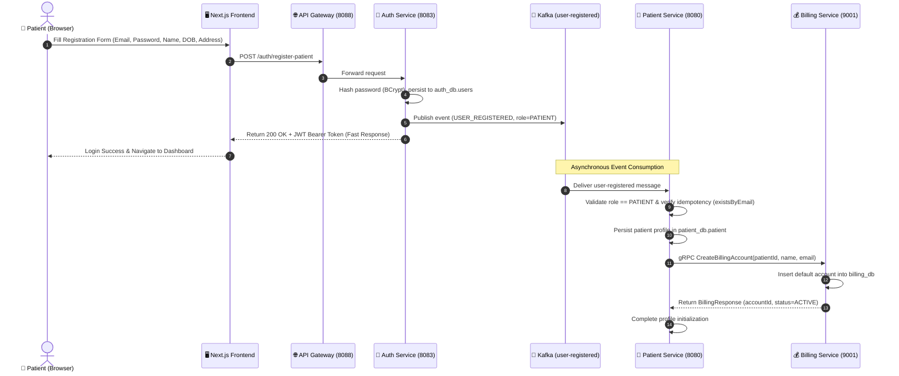
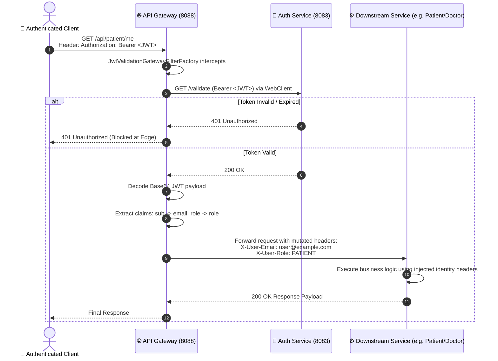
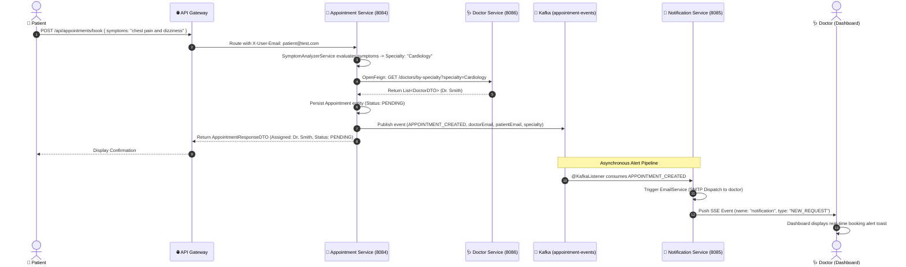
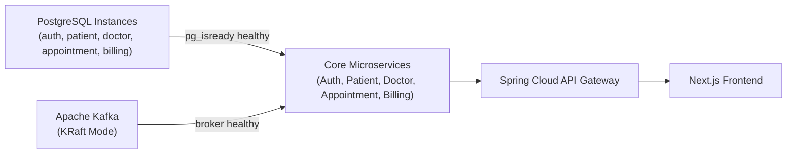

# 🏥 Patient Management System — Enterprise Microservices Platform

[](https://www.oracle.com/java/)
[](https://spring.io/projects/spring-boot)
[](https://spring.io/projects/spring-cloud)
[](https://nextjs.org/)
[-red.svg?style=flat&logo=apachekafka)](https://kafka.apache.org/)
[](https://grpc.io/)
[](https://www.postgresql.org/)
[](https://www.docker.com/)

A production-grade, distributed healthcare management platform engineered with modern microservices design patterns. This system automates patient onboarding, automated billing account provisioning, symptom-driven doctor triage, real-time appointment scheduling, and instant cross-channel notifications.

---

## 📑 Table of Contents

- [Architectural Overview](#-architectural-overview)
- [Microservices Ecosystem](#-microservices-ecosystem)
- [Core Architectural Decisions & Tradeoffs](#-core-architectural-decisions--tradeoffs)
  - [1. Database-per-Service Pattern](#1-database-per-service-pattern)
  - [2. Edge Security & API Gateway Pattern](#2-edge-security--api-gateway-pattern)
  - [3. Asynchronous Event-Driven Architecture (Apache Kafka)](#3-asynchronous-event-driven-architecture-apache-kafka)
  - [4. High-Performance Inter-Service RPC (gRPC + Protobuf)](#4-high-performance-inter-service-rpc-grpc--protobuf)
  - [5. Declarative Synchronous Communication (Spring Cloud OpenFeign)](#5-declarative-synchronous-communication-spring-cloud-openfeign)
  - [6. Real-Time Event Streaming (Server-Sent Events)](#6-real-time-event-streaming-server-sent-events)
  - [7. Symptom-Driven Automated Doctor Triage](#7-symptom-driven-automated-doctor-triage)
- [End-to-End Request Flows](#-end-to-end-request-flows)
  - [Flow 1: Event-Driven Patient Registration & Account Provisioning](#flow-1-event-driven-patient-registration--account-provisioning)
  - [Flow 2: Authenticated Client Request via API Gateway](#flow-2-authenticated-client-request-via-api-gateway)
  - [Flow 3: Appointment Booking, Specialty Triage & Live Notification](#flow-3-appointment-booking-specialty-triage--live-notification)
- [Inter-Service Communication Matrix](#-inter-service-communication-matrix)
- [Repository Structure](#-repository-structure)
- [Getting Started & Local Deployment](#-getting-started--local-deployment)
  - [Prerequisites](#prerequisites)
  - [Single-Command Launch (Docker Compose)](#single-command-launch-docker-compose)
  - [Container Healthcheck & Startup Orchestration](#container-healthcheck--startup-orchestration)
  - [Local Ports & Services Reference](#local-ports--services-reference)
- [API Gateway Routes & Key Endpoints](#-api-gateway-routes--key-endpoints)
- [Future Enhancements](#-future-enhancements)

---

## 🏛️ Architectural Overview

The system transitions from traditional monolithic coupling into domain-oriented, independently scalable services following Domain-Driven Design (DDD) principles.

```mermaid
graph TB
    subgraph ClientLayer["🖥️ Presentation Layer"]
        FE["Next.js 16 Web Client<br/>(React 19, Shadcn UI, Tailwind CSS 4)<br/>Port: 3000"]
    end

    subgraph EdgeLayer["🌐 Edge & Security Layer"]
        GW["Spring Cloud Gateway<br/>(Reactive WebFlux + JWT Filter)<br/>Port: 8088"]
    end

    subgraph EventMesh["📨 Event Streaming Backbone"]
        KF["Apache Kafka (KRaft Mode)<br/>Port: 9092<br/>Topics: user-registered, appointment-events, patient"]
    end

    subgraph ServiceLayer["⚙️ Domain Microservices"]
        AS["Auth Service<br/>Port: 8083"]
        PS["Patient Service<br/>Port: 8080"]
        DS["Doctor Service<br/>Port: 8086"]
        APS["Appointment Service<br/>Port: 8084"]
        BS["Billing Service<br/>Port: 8081 (HTTP) / 9001 (gRPC)"]
        NS["Notification Service<br/>(Stateless SSE + Email)<br/>Port: 8085"]
        AN["Analytics Service<br/>Port: 8082"]
    end

    subgraph PersistenceLayer["💾 Isolated Persistence (PostgreSQL 16)"]
        ADB[("auth_db<br/>Port: 5433")]
        PDB[("patient_db<br/>Port: 5434")]
        DDB[("doctor_db<br/>Port: 5435")]
        APDB[("appointment_db<br/>Port: 5436")]
        BDB[("billing_db<br/>Port: 5437")]
    end

    %% Client to Gateway
    FE -->|HTTP / REST + Bearer Token| GW

    %% Gateway Routing
    GW -->|/auth/**| AS
    GW -->|/api/patient/**| PS
    GW -->|/api/doctors/**| DS
    GW -->|/api/appointments/**| APS
    GW -->|/api/notifications/**| NS
    GW -->|/api/billing/**| BS

    %% DB Connections
    AS --- ADB
    PS --- PDB
    DS --- DDB
    APS --- APDB
    BS --- BDB

    %% Inter-service & Event Communications
    AS -.->|Publish: user-registered| KF
    KF -.->|Consume: user-registered| PS
    PS ==>|gRPC / HTTP-2 (Protobuf)| BS
    APS ==>|OpenFeign REST Client| DS
    APS -.->|Publish: appointment-events| KF
    KF -.->|Consume: appointment-events| NS
    PS -.->|Publish: patient events| KF
    KF -.->|Consume: events| AN
    NS -.->|Real-Time SSE Stream| FE

    classDef client fill:#3b82f6,stroke:#1d4ed8,color:#fff;
    classDef gateway fill:#8b5cf6,stroke:#6d28d9,color:#fff;
    classDef service fill:#10b981,stroke:#047857,color:#fff;
    classDef kafka fill:#ef4444,stroke:#b91c1c,color:#fff;
    classDef db fill:#f59e0b,stroke:#b45309,color:#fff;

    class FE client;
    class GW gateway;
    class AS,PS,DS,APS,BS,NS,AN service;
    class KF kafka;
    class ADB,PDB,DDB,APDB,BDB db;
```

---

## 📦 Microservices Ecosystem

| Service | Internal Port | Primary Technology | Key Responsibilities |
|---|---|---|---|
| **API Gateway** | `8088` | Spring Cloud Gateway (WebFlux) | Single ingress, CORS termination, JWT verification, and claims propagation. |
| **Auth Service** | `8083` | Spring Boot 3, Spring Security, JPA | User signup/login, HMAC-SHA256 JWT minting, publishes `user-registered` events. |
| **Patient Service** | `8080` | Spring Boot 3, JPA, gRPC Client | Patient profile management, Kafka onboarding listener, triggers billing creation via gRPC. |
| **Doctor Service** | `8086` | Spring Boot 3, JPA | Doctor directory, specialty categorization, consultation fees, and doctor metadata lookup. |
| **Appointment Service** | `8084` | Spring Boot 3, OpenFeign, JPA | Symptom analysis & specialty triage, doctor scheduling, and status lifecycle management. |
| **Billing Service** | `8081` (REST)<br/>`9001` (gRPC) | Spring Boot 3, gRPC Server, Protobuf | High-speed billing account provisioning, invoice records, and simulated payment processing. |
| **Notification Service** | `8085` | Spring Boot 3, Spring Web, JavaMailSender | Stateless real-time event distribution over Server-Sent Events (SSE) and SMTP emails. |
| **Analytics Service** | `8082` | Spring Boot 3, Kafka Consumer | Asynchronous event telemetry and reporting consumer. |
| **Frontend** | `3000` | Next.js 16 (App Router), React 19, Shadcn UI | Interactive patient portal, doctor dashboard, live notification toaster, and appointment booking. |

---

## 💡 Core Architectural Decisions & Tradeoffs

### 1. Database-per-Service Pattern
* **Design Decision:** Each business capability maintains an independent PostgreSQL database with dedicated schemas, user credentials, and Docker persistent volumes.
* **Why not a Shared Database?**
  * *Tight Coupling Avoidance:* Modifying column schemas in `patient_db` never disrupts `auth_db` or `billing_db`.
  * *Isolated Blast Radius:* A database connection pool exhaustion or crash in `doctor_db` leaves login and billing operational.
  * *Independent Scaling:* Database resources can be scaled per domain (e.g., intensive reads on appointments vs. write-heavy auth logs).
* **Tradeoff:** Joining cross-domain data via standard SQL `JOIN` is impossible. Data correlation is achieved through event choreography and lightweight declarative client lookups.

### 2. Edge Security & API Gateway Pattern
* **Design Decision:** Centralized authentication filter built upon Spring Cloud Gateway using non-blocking Netty (`JwtValidationGatewayFilterFactory`).
* **Implementation Details:**
  * Downstream microservices do **not** re-parse or validate cryptographic signatures.
  * The Gateway validates the bearer token via Auth Service (`/validate`), decodes the claims, and injects identity headers (`X-User-Email`, `X-User-Role`) down to target microservices.
  * **Fallback Handling for SSE:** Standard browser `EventSource` lacks support for custom HTTP request headers. The gateway filter falls back to reading `?token=<JWT>` query parameters for `/api/notifications/stream`.
* **Technology Tradeoff:**
  * *Spring Cloud Gateway (Selected):* Reactive non-blocking I/O model handles high concurrent connections with minimal worker threads compared to legacy blocking architectures (e.g., Netflix Zuul 1.x).
  * *Nginx / Envoy:* Faster static proxies, but implementing dynamic Spring Security context parsing and native discovery integration is more complex to maintain.

### 3. Asynchronous Event-Driven Architecture (Apache Kafka)
* **Design Decision:** Apache Kafka in **KRaft mode** (Kafka Raft Metadata Mode, eliminating ZooKeeper dependencies) for cross-service eventual consistency.
* **Key Event Pipelines:**
  1. `user-registered`: Emitted upon user creation in Auth Service; consumed by Patient Service to automatically instantiate a clinical patient entity with idempotency checks.
  2. `appointment-events`: Emitted upon booking (`APPOINTMENT_CREATED`) and doctor approval (`APPOINTMENT_CONFIRMED`); consumed by Notification Service.
  3. `patient`: Protobuf-serialized clinical events consumed by Analytics Service.
* **Tradeoff vs. RabbitMQ:**
  * *Kafka (Selected):* Persistent immutable commit log enables event replay on service restarts, partition-based horizontal scaling, and audit traceability.
  * *RabbitMQ:* Simpler push-based broker with fine-grained routing, but lacks native distributed stream replay without specialized plugins.

### 4. High-Performance Inter-Service RPC (gRPC + Protobuf)
* **Design Decision:** High-speed synchronous account creation between Patient Service and Billing Service executed over **gRPC on HTTP/2**.
* **Contract Definition (`billing_service.proto`):**
  ```protobuf
  syntax = "proto3";
  option java_multiple_files = true;
  option java_package = "billing";

  service BillingService {
      rpc CreateBillingAccount (BillingRequest) returns (BillingResponse);
  }

  message BillingRequest {
      string patientId = 1;
      string name = 2;
      string email = 3;
  }

  message BillingResponse {
      string accountId = 1;
      string status = 2;
  }
  ```
* **Tradeoff vs. REST/JSON:**
  * *Serialization Efficiency:* Google Protobuf encodes data in compact binary, cutting payload size by up to 80% compared to verbose JSON strings.
  * *Multiplexing:* HTTP/2 allows multiple RPC calls over a single persistent TCP connection, preventing Head-of-Line blocking and drastically reducing latency.
  * *Contract Safety:* `.proto` definitions eliminate client-server contract drifts via compile-time stub generation.

### 5. Declarative Synchronous Communication (Spring Cloud OpenFeign)
* **Design Decision:** Spring Cloud OpenFeign interfaces are used when immediate synchronous responses are mandatory (e.g., querying doctor availability and specialties during appointment creation).
* **Interface Example (`DoctorServiceClient.java`):**
  ```java
  @FeignClient(name = "doctor-service", url = "${doctor-service.url}")
  public interface DoctorServiceClient {
      @GetMapping("/doctors/by-specialty")
      List<DoctorDTO> getDoctorsBySpecialty(@RequestParam("specialty") String specialty);

      @GetMapping("/doctor")
      DoctorDTO getDoctorByEmail(@RequestParam("email") String doctorEmail);
  }
  ```
* **Tradeoff vs. Spring WebClient / RestTemplate:**
  * *OpenFeign (Selected):* Eliminates boilerplate HTTP connection, serialization, and URL building code into clean declarative Java interfaces.
  * *RestTemplate:* Outdated and in maintenance mode.
  * *WebClient:* Reactive alternative, but introduces unnecessary `Mono`/`Flux` complexity for straightforward blocking lookups.

### 6. Real-Time Event Streaming (Server-Sent Events)
* **Design Decision:** Unidirectional real-time dashboard notifications implemented using HTTP Server-Sent Events (`SseEmitter`) in the Notification Service.
* **Tradeoff vs. WebSockets & Long Polling:**
  * *SSE (Selected):* Operates over standard HTTP without protocol upgrade handshakes, supports native browser automatic reconnection, and is ideal for one-way server-to-client updates (new requests, confirmation toasts).
  * *WebSockets:* Full-duplex communication is excessive for notification banners and incurs server-side connection state management complexity.
  * *Long Polling:* Highly inefficient, continuously opening and tearing down TCP connections.

### 7. Symptom-Driven Automated Doctor Triage
* **Design Decision:** Automated rule-based medical triage mapping natural-language patient symptoms to clinical departments:
  * `"chest pain"`, `"heart"`, `"blood pressure"` ➡️ **Cardiology**
  * `"skin"`, `"rash"`, `"acne"` ➡️ **Dermatology**
  * `"bone"`, `"joint"`, `"fracture"` ➡️ **Orthopedics**
  * `"headache"`, `"migraine"`, `"seizure"` ➡️ **Neurology**
  * `"stomach"`, `"digestion"` ➡️ **Gastroenterology**
  * Default Fallback ➡️ **General Medicine**
* **Resilience Pattern:** If no specialist is available in the identified field, the service gracefully falls back to available General Practitioners before rejecting the booking.

---

## 🔄 End-to-End Request Flows

### Flow 1: Event-Driven Patient Registration & Account Provisioning



---

### Flow 2: Authenticated Client Request via API Gateway



---

### Flow 3: Appointment Booking, Specialty Triage & Live Notification



---

## 🔀 Inter-Service Communication Matrix

| Source Service | Target Service | Mechanism | Data Format | Rationale |
|---|---|---|---|---|
| **Frontend** | **API Gateway** | HTTP/1.1 REST | JSON | Standard browser communication and CORS compatibility. |
| **API Gateway** | **Auth Service** | Reactive HTTP (WebClient) | Headless HTTP 200/401 | Edge JWT signature & validity verification. |
| **API Gateway** | **Microservices** | HTTP/1.1 REST (Reverse Proxy) | JSON + Injected Headers | Header enrichment (`X-User-Email`, `X-User-Role`). |
| **Auth Service** | **Kafka** | Event Producer | JSON | Fire-and-forget user registration broadcast. |
| **Patient Service** | **Billing Service** | **gRPC over HTTP/2** | **Protobuf Binary** | High-throughput, low-latency, strictly-typed account provisioning. |
| **Appointment Service** | **Doctor Service** | **OpenFeign Client** | JSON | Declarative, synchronous doctor lookup during triage. |
| **Appointment Service** | **Kafka** | Event Producer | JSON | Decoupled notification lifecycle triggering (`appointment-events`). |
| **Kafka** | **Notification Service** | Event Consumer | JSON | Event-driven notification dispatch. |
| **Notification Service** | **Frontend** | **Server-Sent Events (SSE)** | `text/event-stream` | Lightweight, continuous server-to-client push updates. |

---

## 📂 Repository Structure

```text
Patient-Management/
├── apigateway/                 # Spring Cloud Gateway (Port 8088)
│   └── src/main/java/com/pm/apigateway/
│       ├── filter/             # JwtValidationGatewayFilterFactory (claim extraction)
│       └── exception/          # Custom gateway error handling
├── authService/                # Identity & Access Management (Port 8083)
│   └── src/main/java/com/pm/authService/
│       ├── config/             # Spring Security configuration (BCrypt)
│       ├── kafka/              # UserRegisteredProducer
│       ├── utils/              # JwtUtil (HMAC-SHA256 token operations)
│       └── model/              # User entity & Role enum
├── patientservice/             # Patient Domain & Medical Records (Port 8080)
│   ├── src/main/proto/         # billing_service.proto & patient_event.proto
│   └── src/main/java/com/pm/patientservice/
│       ├── grpc/               # BillingServiceGrpcClient
│       └── kafka/              # UserRegisteredEventListener (auto-create patient)
├── doctorService/              # Doctor Registry & Profiles (Port 8086)
│   └── src/main/java/com/pm/doctorService/
│       └── controller/         # Specialty search & profile management
├── appointmentService/         # Scheduling & Triage Engine (Port 8084)
│   └── src/main/java/com/pm/appointmentService/
│       ├── feign/              # DoctorServiceClient (OpenFeign)
│       ├── kafka/              # AppointmentEventProducer
│       └── service/            # SymptomAnalyzerService (Triage logic)
├── billingservice/             # Billing & Accounts (Ports: 8081 HTTP / 9001 gRPC)
│   ├── src/main/proto/         # billing_service.proto contract definition
│   └── src/main/java/com/pm/billingservice/
│       └── gRPC/               # BillingServicegRPC implementation
├── notificationService/        # Real-Time Event Dispatcher (Port 8085)
│   └── src/main/java/com/pm/notificationService/
│       ├── listner/            # AppointmentEventListener (@KafkaListener)
│       └── service/            # SseNotificationService & EmailService
├── analyticsservice/           # Event Telemetry Service (Port 8082)
├── frontend/                   # Modern Web Application (Port 3000)
│   └── src/
│       ├── app/                # Next.js 16 App Router (dashboard, auth, booking)
│       ├── components/         # Shadcn UI primitives & custom components
│       └── lib/                # API client with JWT attachment logic
├── docker-compose.yml          # Complete 13-container multi-stage orchestration
└── architecture_analysis.md    # In-depth architectural diagnosis and transitions
```

---

## 🚀 Getting Started & Local Deployment

### Prerequisites
- **Docker Engine** (v24.0+) & **Docker Compose v2**
- **Java Development Kit (JDK 21)** (optional, if running services locally outside Docker)
- **Node.js 20+** & **npm** (optional, for standalone frontend development)

### Single-Command Launch (Docker Compose)

Clone the repository and spin up the complete distributed environment with a single command:

```bash
# Clone the repository
git clone https://github.com/your-username/Patient-Management.git
cd Patient-Management

# Spin up all 13 containers in detached mode
docker compose up -d --build
```

To tail the logs across all microservices:
```bash
docker compose logs -f
```

To shut down and wipe persistent volume data for a clean slate:
```bash
docker compose down -v
```

### Container Healthcheck & Startup Orchestration

The `docker-compose.yml` file prevents startup race conditions using container-level healthchecks:
1. **Databases First:** PostgreSQL instances run `pg_isready` health tests every 5 seconds.
2. **Kafka in KRaft:** The Apache Kafka broker initializes in KRaft mode and validates topic availability before dependent microservices start.
3. **Graceful Microservice Boot:** Dependent backend services (such as `patient-service`) evaluate `condition: service_healthy` on databases and Kafka before spinning up.
4. **Gateway & UI Last:** The API Gateway starts only after downstream target microservices report active status.



### Local Ports & Services Reference

| Component | Host Port | Protocol | Purpose / URL |
|---|---|---|---|
| **Frontend UI** | `3000` | HTTP | Patient & Doctor Portal: [http://localhost:3000](http://localhost:3000) |
| **API Gateway** | `8088` | HTTP | Main API Gateway Ingress: [http://localhost:8088](http://localhost:8088) |
| **Auth Service** | `8083` | HTTP | Authentication & JWT Endpoints |
| **Patient Service** | `8080` | HTTP | Patient Records API |
| **Doctor Service** | `8086` | HTTP | Doctor Registry API |
| **Appointment Service**| `8084` | HTTP | Scheduling & Triage API |
| **Billing Service** | `8081` / `9001` | HTTP / gRPC | REST Billing Endpoints & gRPC Server |
| **Notification Service**| `8085` | HTTP / SSE | Notification & SSE Stream |
| **Analytics Service** | `8082` | HTTP | Telemetry Consumer |
| **Apache Kafka** | `9092` | TCP (PLAINTEXT)| Kafka Broker Port |
| **auth-db** | `5433` | TCP | PostgreSQL Auth Database |
| **patient-db** | `5434` | TCP | PostgreSQL Patient Database |
| **doctor-db** | `5435` | TCP | PostgreSQL Doctor Database |
| **appointment-db** | `5436` | TCP | PostgreSQL Appointment Database |
| **billing-db** | `5437` | TCP | PostgreSQL Billing Database |

---

## 🌐 API Gateway Routes & Key Endpoints

All external HTTP requests are routed through the API Gateway on port `8088`. Protected routes require an `Authorization: Bearer <token>` header (or `?token=<token>` for SSE).

### 1. Authentication (`/auth/**`)
- `POST /auth/register` — Register a doctor account (role `USER`).
- `POST /auth/register-patient` — Register a patient account (role `PATIENT`).
- `POST /auth/login` — Authenticate credentials and receive a signed JWT.
- `GET /auth/validate` — Gateway verification filter hook.

### 2. Patient Domain (`/api/patient/**`)
- `GET /api/patient` — List all registered patients.
- `GET /api/patient/{id}` — Fetch specific patient profile.
- `POST /api/patient` — Create patient profile manually (doctor initiated).
- `PUT /api/patient/{id}` — Update demographic/address information.

### 3. Doctor Domain (`/api/doctors/**`)
- `GET /api/doctors` — List all registered doctors.
- `GET /api/doctors/by-specialty?specialty={name}` — Filter doctors by medical specialty.
- `GET /api/doctor?email={email}` — Fetch profile for specific doctor.

### 4. Appointment Domain (`/api/appointments/**`)
- `POST /api/appointments/book` — Book appointment with automated symptom triage.
- `GET /api/appointments/patient` — Get appointment history for the logged-in patient.
- `GET /api/appointments/doctor/pending` — Fetch pending approval requests for doctors.
- `PUT /api/appointments/{id}/status` — Update appointment status (`CONFIRMED`, `CANCELLED`, `COMPLETED`).

### 5. Live Notifications (`/api/notifications/**`)
- `GET /api/notifications/stream?token={jwt}` — Open persistent Server-Sent Events (SSE) stream.

---

## 🔮 Future Enhancements

- [ ] **AI-Powered Clinical NLP Triage:** Transition rule-based keyword symptom matching to a fine-tuned LLM / clinical BERT model for probabilistic diagnostic classification.
- [ ] **Distributed Tracing & Observability:** Implement OpenTelemetry with Micrometer Tracing, sending traces to Grafana Tempo or Zipkin for end-to-end request latency profiling.
- [ ] **Circuit Breakers & Fault Tolerance:** Wrap inter-service Feign calls with Resilience4j circuit breakers and fallbacks to handle downstream outages gracefully.
- [ ] **Kubernetes Helm Charts:** Migrate from Docker Compose to cloud-native Helm charts supporting Horizontal Pod Autoscaling (HPA) and automated secret injection.

---

## 👨‍💻 Author

Built with focus on clean architecture, distributed consistency, and scalable software design.

- **GitHub:** [kamleshwarpradhan](https://github.com/kamleshwarpradhan)
- **LinkedIn:** [Kamleshwar Pradhan](https://www.linkedin.com)
- **Project Repository:** [Patient-Management](https://github.com/kamleshwarpradhan/Patient-Management)
