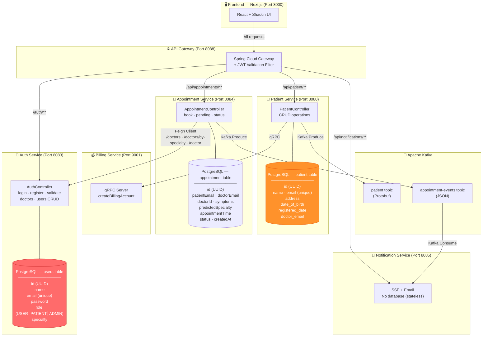
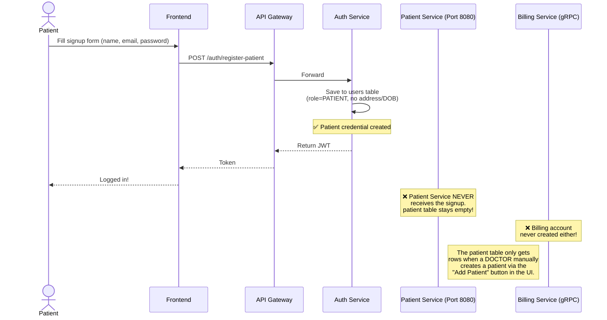
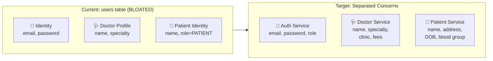
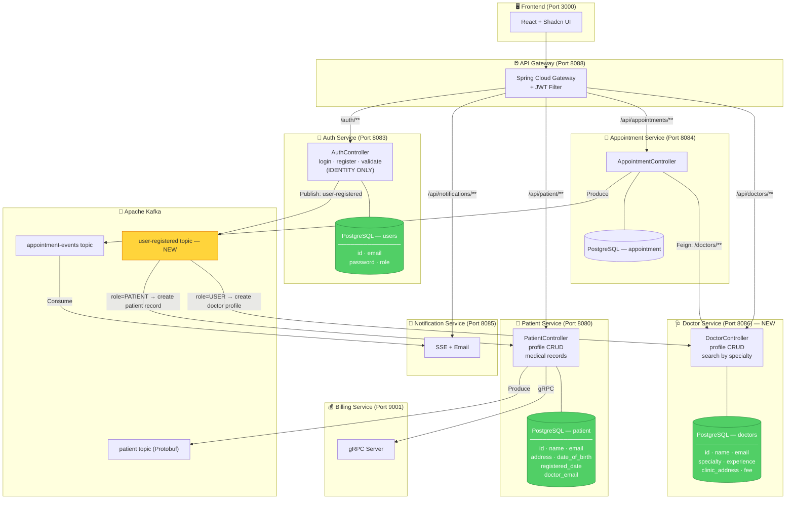
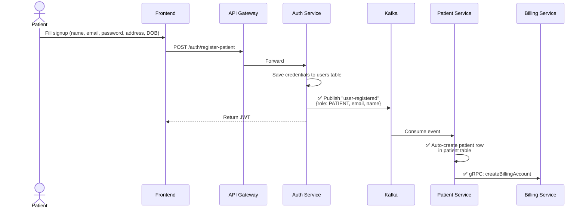
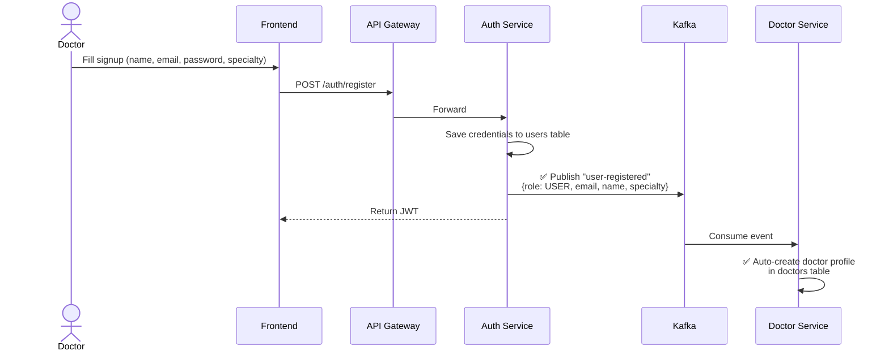

# Patient Management — Architecture Overview

> [!NOTE]
> Based on a thorough scan of every microservice, entity model, config file, and database schema in the codebase.

---

## Current Architecture

---

## Database Schema Summary (Current)

| Service | DB Type | Table/Collection | Key Fields |
|---|---|---|---|
| Auth Service | PostgreSQL | `users` | `id`, `name`, `email`, `password`, `role`, `specialty` |
| Patient Service | PostgreSQL | `patient` | `id`, `name`, `email`, `address`, `date_of_birth`, `registered_date`, `doctor_email` |
| Appointment Service | PostgreSQL | `appointment` | `id`, `patientEmail`, `doctorEmail`, `doctorId`, `symptoms`, `predictedSpecialty`, `status` |
| Billing Service | PostgreSQL | gRPC-managed billing accounts | `patientId`, `name`, `email` |
| Notification Service | **None** | Stateless (SSE + Email) | — |

---

## The Bug: Broken Patient Signup Flow

> [!CAUTION]
> **Root Cause:** `AuthService.registerPatient()` only saves to the `users` table. There is no Kafka event, no Feign call, and no synchronization mechanism to create a corresponding row in the Patient Service's `patient` table. The Patient Service's `patient` table is only populated when a **Doctor** manually clicks "Add Patient" in the dashboard.

---

## What the Auth Service is Doing Wrong

The Auth Service (`users` table) is currently storing **3 different domain concerns** in one table:

---

## Proposed Architecture (After Transition)

---

## Proposed Signup Flows (Event-Driven)

### Patient Signup (Fixed)

### Doctor Signup (New)

---

## Before vs After

| Aspect | 🔴 Current | 🟢 After Transition |
|---|---|---|
| **Auth Service** | Stores identity + name + specialty | Identity only (email, password, role) |
| **Doctor Data** | In Auth `users` table | Own `Doctor Service` on port 8086 |
| **Patient Signup** | Only saved in `users` table | Auto-synced to `patient` table via Kafka |
| **Billing Account** | Only created on manual "Add Patient" | Auto-created on patient signup |
| **Specialty Lookups** | Feign → Auth Service | Feign → Doctor Service |
| **Total Services** | 6 (Auth, Patient, Appointment, Notification, Billing, Gateway) | 7 (+ Doctor Service) |
| **Coupling** | Auth is a bottleneck | Each domain scales independently |
